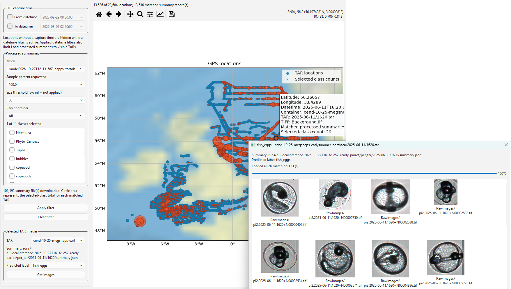
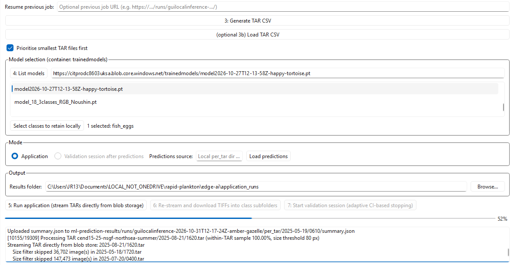
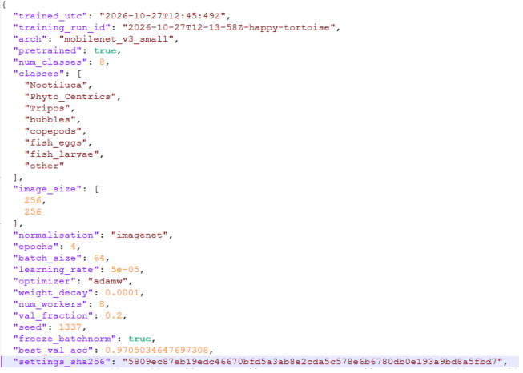

# RAPID-plankton
RAPID Plankton exists because it is now surprisingly easy to photograph plankton and surprisingly difficult to cope with the consequences. A PI-10 can sit aboard a ship producing a continuous stream of images of the tiny organisms and particles passing through seawater. This is scientifically excellent news. It is less excellent news if “continuous stream of images” means billions of files which need to be stored, moved, measured, classified, checked and, ideally, converted into something informative without using a data center high performance compute.

RAPID Plankton connects the imager to local or edge computing so that some of this work can happen close to the instrument. Images can be filtered, measured and classified as they arrive, while the full collection remains available for later analysis. The point is not to automate away scientific judgement. It is to prevent scientific judgement being defeated by the sheer number of TIFFs demanding it.

## Upstream code
**cefas-pi-10-edge-ai is a public release of the internally held repository <https://github.com/CefasRepRes/rapid-plankton> Git history may be squashed for security purposes and previous versions available in the private internal repository are not publicly visible.**

## Acknowledgements
AI health warning: Credit where it is due to GPT-6 Luna and Sol (this applies to code in /gui/ contact: <a href="https://github.com/JoeRibeiro">JoeRibeiro</a>).
Code found in the “/edge-ai/” folder has been lightly modified from that of the original author (<a href="https://github.com/RobBlackwell">RobBlackwell</a>), who developed it in collaboration with Noushin Eftekhari at the Turing institute and Eric Payne at Cefas. Overall ownership goes to James Scott and Sophie Pitois who have been responsible for underlying research, funding, maintenance of the plankton imager for years. 

## The scale problem
In reasonably calm conditions, the Pi-10 might produce around 5,000 images a minute and roughly 50 GB of data a day. Unfortunately, the sea has not agreed to remain reasonably calm for the convenience of our data collection.

In bad weather, or when the ship's thrusters must send bubbles past the intake, data volumes can increase by an order of magnitude. Upon receipt or playback of these data, the result can be millions of tiny files accompanied by millions of filesystem operations.

RAPID therefore tries to avoid doing expensive things until it has established that they are necessary. Image dimensions can be inspected with pyvips without decoding the full image; undersized images can be rejected immediately; accepted images are resized before becoming tensors; TAR archives can be streamed rather than downloaded and unpacked wholesale; inference is batched on the GPU; and multiple archives can be processed concurrently. If only a quick view of a survey is required, the software can sample several positions throughout each TAR rather than devotedly reading every byte.

There is also an option to process the smallest TARs first. This sounds like an almost offensively simple idea, but unusually large archives are often large because they contain huge numbers of tiny bubble images. Starting with smaller archives can therefore reveal the useful parts of a survey without first spending several hours proving that the North Sea contained bubbles.

**Faced with a large dataset, the temptation is to assume it needs a data centre.** It may do. However, the general principle here is fairly unglamorous but important: **do less unnecessary work**. A workstation's CPU, GPU, memory and storage bandwidth can then be spent on the part of the dataset that actually addresses the scientific question.

## Provenance and model versioning
Machine-learning models have a slightly troublesome habit of acquiring names such as model_final_v7_REAL_final.pt, after which nobody can remember precisely what produced them.

RAPID takes a more suspicious view of the whole business and enforces some light version control.

Every trained model can carry the Git commit SHA of the software that created it. It can also record whether the working tree was *dirty*, which is Git's wonderfully judgemental term for “James had changed the code but hadn't committed it yet”. That distinction matters: knowing the commit is useful only until somebody quietly modifies three functions and trains another model. All the while, we need the flexibility to let people change the underlying code.

The training data receive similar treatment. Individual files are SHA-256 hashed and combined into a fingerprint for the training folder. If a training dataset is changed without creating a new formal dataset version, the fingerprint changes. In other words, the software does not merely ask *what is this model called?* It tries to preserve enough evidence to answer the much more useful question: *what, exactly, did we do to produce it?*

Training configuration is also preserved. Epochs, learning rate, optimiser and alternative loss strategies live in YAML configuration, and the settings used for a run are retained as JSON alongside the resulting model. When that model is later selected for inference, the application can recover information such as its architecture and the order of the class labels rather than requiring the user to reconstruct its history from memory, filenames and optimism.

And because, as it turns out, people are not especially good at discussing hexadecimal hashes and timestamps, each run also gets a memorable name such as *plucky-otter*. Two scientists can therefore talk about a model without resorting to, “No, not that one, the other one beginning 7f3a.”

All of this may sound like a small convenience, or perhaps a slightly controlling amount of bookkeeping. But taken together, these measures turn a .pt file from **“some weights we trained once”** into something much closer to a reproducible scientific artefact: a model with a record of the code, data and configuration that produced it.

## Do less unnecessary work
The RAPID GUI allows only a fraction of a TAR archive to be examined. Crucially, that fraction is taken from several predetermined positions throughout the archive rather than simply reading the first 1% and hoping those six seconds of imagery are representative of the ten minutes that happened afterwards.

For abundant classes, even a small glimpse at the image stream can be enough to reveal broad patterns. You may see a transition from bubbles to *Tripos*, identify good vs poor quality sections of a survey, or see the signal associated with crossing a tidal front. Rare organisms remain rare, unfortunately, and finding those still requires substantially more complete processing.

But it offers a useful alternative to “I need the full results”, i.e. **“I need to know what is in this enormous dataset before I make expensive promises about what we can do with it”.** That scaleability runs through quite a lot of the RAPID gui's design.

## Why are we doing all of this?
**The real attraction of automated plankton imaging is not simply that computers can count faster than people. It is that machine learning changes the practical scale, effort and turnaround of observation.** If every image requires a human being to inspect it, the size of the scientific question is ultimately constrained by the number of specimens that we can count by eye. If machines can perform the first pass, observations can be made at greater temporal scales and expert attention can be concentrated on ambiguous, unusual or genuinely interesting cases. The ambition here is to stop **the rate at which a person can look at plankton** from determining the frequency and scale at which we are capable of studying the sea.

Using a computer to classify images does not remove uncertainty. In some ways it makes uncertainty more important, as sampling limitations, model error and taxonomic ambiguity still have to follow the result through to its interpretation. This is particularly relevant when a model inevitably performs worse in conditions and environments misaligned to those it was trained on.

This is why validation sessions are important - quantifying each of the sources of error in isolation is a bit tricky, so it is least contentious if, rather than running a model on autopilot, a plankton taxonomist confirms that the model is performing okay based on a small but representative fraction of the available images.

## Design decisions (some intentional, some reactive…)

### Provenance and reproducibility
- The latest git SHA is stored alongside your trained model so it is possible to investigate the state of the code at the time the model was trained. The SHA may be stored with a **dirty flag**, so you can tell when a model was trained from uncommitted code.

- **Training dataset fingerprints:** each training dataset's SHA-256 is hashed into one hash per folder. Given that training libraries are at most a few hundred thousand images (not many) it is preferable that a new version is made if they are updated. But the dataset fingerprint means data can be traced back to the training library (or it can be verified if the underlying training libraries have been changed directly).

- **Model and inference run names like 2026-…Z-plucky-otter** keep a sortable timestamp which makes models and inference sessions easy to remember and say aloud.

- **Model training yaml** which gives quite a lot of freedom as to how the model can be trained, e.g. there is a “training_defaults_alternative(Aggressive minority penalty - use this if you hate false negatives for the rarest class).yaml” and a “training_defaults_alternative(Uses focal loss which modifies cross-entropy to downweight easy examples).yaml” (concise, I know). Inside those yamls the user can specify things like the number of epochs, learning_rate, optimiser, and those settings get preserved in a json.

- **The settings JSON is uploaded with the model** (model\<runid\>.pt ↔ modeltrainsettings\<runid\>.json). This means we know both WHAT dataset was used and HOW we trained a model around the dataset. The model application tab fetches it automatically and loads the associated model architecture (resnet, mobilenet etc) and loads the class names.

### Data handling at scale
- **The option to read a fraction of the file from five evenly spaced predetermined byte ranges** of the TAR instead of only the start. This is helpful if you only want to have a glimpse at your entire survey, without waiting too long, but also want a representative subsample. With this method, trends in the most prevalent classes become apparent when looking at even only 1% of the tar contents. Rarest classes of course still require full processing of the tar, but small percentages can still diagnose data quality, identify the passage over a tidal front or e.g. the transition from a “predominantly bubbles” to “predominantly tripos”.

- **Resume from a previous job URL:** Jobs have an associated manifest (which containers, which tars, how much subsampling, skip small images etc). If a job needs to be stopped and resumed, pasting it restores the lot and skips TARs already processed.

### Validation workflow
- **The review queue is balanced** across predicted classes and source TARs – we restream to get 500 preferred images, prioritising the rare classes.

- **A stopping banner turns green** once each class has enough validated examples according to a predefined rule (I need to check what this was).

- **Validator metadata is required,** and you fill it in while images preload.

- **Validated images go back into training-libs** with a dataset.json that records where they came from and the error model. This closes the train → apply → validate → retrain loop.

Browser sign-in happens once per session and the token is cached. There is also ability to export ML inference results as a map html, so it works offline (for example on a ship), or using the built-in interactive map that lets you retrieve specific class-tenbin images from your survey.

## Disclaimer
**This repository contains research software released to support scientific transparency and reproducibility. Users should read the accompanying DISCLAIMER.md before using this software, particularly for any operational, regulatory or decision-making application.**

**The software was developed at Cefas with contributions from the National Oceanography Centre and the Alan Turing Institute.**

## Contents
### Gui/
**The RAPID Plankton GUI is a PySide6 desktop app with tabs for model training, applying and validating trained models, viewing data and edge-AI processing. It has been developed mostly by design but partly also grown out of necessity as a MLOps central console for the plankton imager.**

### edge-ai/
**A Python application intended to run on an NVIDIA Jetson or similar Linux low-power-high-throughput edge device system. It receives images transmitted over UDP from the PI10, classifies them, and sends summary statistics to a microsoft azure message bus and ultimately a database. See [edge-ai/README.md](https://github.com/CefasRepRes/rapid-plankton/blob/main/edge-ai/README.md) for setup and usage instructions.**

## FAQs

### Why image plankton instead of only using a net?
Nets are valuable because they provide physical specimens and support established taxonomic methods. Flow-cell imaging offers continuous, geolocated observations with in situ size information and no requirement to preserve any observed organisms. The strongest monitoring design may use imaging alongside a smaller amount of conventional microscopy rather than treating either as a complete replacement.

### Why collect images underway?
An underway instrument can collect observations while the vessel is transiting or carrying out other work which is an efficient use of ship time.

### Why edge-ai
The edge AI (results in real time) offers a proof of concept for smaller platforms. Since we are able to usefully collect and filter data on a 50W Nvidia jetson device, this is a promising finding if we hope to collect postprocessed summarised plankton imager data long-term on moorings or potentially in the not-too-distant future, using gliders or autonomous surface vehicles. On board the Cefas endeavour, the real-time aspect opens the opportunity to sample reactively if this aligns with a survey’s aims.

### What happens when connectivity is poor?
Result summaries can be buffered or stored locally and transmitted when an appropriate connection is available.

### How does rapid-plankton help deal with the scale of the data?
It often makes sense to apply an image size threshold before handling any of the file contents depending on the specimen of interest. In the gui, other methods that help our throughput come from several layers working together:

- Parallelising a lightweight mobilenet model on the GPU, being served by data loaded on multiple available cpu cores (designed for mobile phones) instead of a resnet model.  
- **Filtering by image dimensions using pyvips** skipping undersized images without decoding pixels. We also r**esize accepted images to model input size with pyvips** before turning them into tensors, avoiding full-resolution tensors in inference.  
- **Processing multiple TARs concurrently** multiple streams, capped by the number of TARs—to overlap storage reads and image processing.  
- **Streaming TARs from Azure in chunks**, so we processes archive members without downloading and extracting each whole archive to disk.  
- **Running inference in batches of 256** with CUDA, reducing per-image model-call overhead and regularly using 50-100% GPU.  
- **Optionally reading only a configurable fraction of each TAR**, spread across five positions, rather than scanning every byte when sampling is enabled.  
- **Optionally processing a survey smallest-largest. Since we know larger tar files are likely to be polluted with small bubbles, we can avoid wasted long processing hours on images of (mostly bubbles).**

In doing all this we can fully use a workstation’s available power, also scaling the size of the job to be proportionate to the scientific question or time available with little compromise.

### Why use TAR?
Early surveys were streamed unarchived and uncompressed direct to disk, which meant uploading millions of standalone cloud objects. The instrument can save directly to TAR, a simple, widely supported sequential, streamable archive format making it easy to “replay” the stream from a chosen time. Simply storing and re-reading from TAR avoids any post-survey conversion.

### Why not use cloud compute?
Local compute lets a scientist explore, filter and classify data without requiring every task to become a cloud project. It can also support work at sea, offline testing with example files and development on familiar desktop hardware. Cloud computes comes with ongoing costs, subscriptions, paperwork sign-offs, maintenance by IT services. Local compute is of course constrained by the capacity of your workstation(s) but provided this is adequate, it is a lower hurdle to cross for many researchers and civil servants. Note that download speeds do matter here, reanalyses at the laboratory often run at the hundreds of megabytes per second.

### What costs are involved in accessing the data?
Keeping data in the cloud and getting it out again both cost money. Storage is charged by volume and by storage tier. To keep costs manageable, most of the raw image archive is held in archive storage. That's the cheapest way to keep data long term, but it can't be read directly. Data have to be moved back into hot storage first, which takes time and adds its own cost. After that, reading the data is charged per operation, and egress is charged for every gigabyte downloaded out of the cloud. Hundreds of terabytes of raw imagery means each of these costs grows quickly with the amount of data requested. So the curated datasets and metadata are the easiest place to start. When raw imagery is needed, RAPID's tools help you choose the subset you actually need, such as particular surveys, time periods or classes, so that only those data have to be moved to hot storage and downloaded.

### How does classification uncertainty affect scientific results?
Counts derived from imperfect classifications are not exact. Model error can be estimated using representative labelled data and propagated into class counts and derived indicators, for example through resampling, probabilistic predictions or confusion-matrix correction. Reporting this uncertainty helps distinguish a clear ecological signal from variation that could plausibly arise from sampling or classification error, and avoids giving an automated workflow more apparent certainty than the evidence supports.

### What previous work does RAPID build on?
RAPID builds on several strands of earlier Cefas and collaborative research. A 2021 Data Study Group between Cefas and The Alan Turing Institute explored automated classification of Plankton Imager imagery using machine-learning approaches, including convolutional neural networks, and provided an important foundation for subsequent work. Further classifier development with Noushin Eftekhari at The Alan Turing Institute explored ResNet and vision-transformer approaches for plankton imagery. RAPID also draws on work by Cefas researchers on representing classification error in ecological analyses, published as Spence et al. (2024), *Avoiding Confusion: Modelling Image Identification Surveys with Classification Errors*. Not all of these approaches are implemented in the current RAPID workflow, but together they have informed its development and provide routes for future improvement. [\[turing.ac.uk\]](https://www.turing.ac.uk/news/publications/data-study-group-final-report-centre-environment-fisheries-and-aquaculture), [\[turing.ac.uk\]](https://www.turing.ac.uk/sites/default/files/2022-07/the_alan_turing_institute_data_study_group_final_report_-_cefas.pdf)

### Can RAPID be used or repurposed by other institutes?
RAPID is an open-source research project under active development. It is built primarily around our own scientific needs and infrastructure, including Azure cloud storage, rather than as a ready-made platform for deployment elsewhere. However, much of the workflow could be adapted: developers could point the input layer at their own storage or local directories, substitute a classifier trained for their taxa, adjust size filters, change the publication and storage components, or reuse individual elements such as TAR streaming, morphology or GPS processing. External use will likely require some adaptation, but by making the software available in line with FAIR principles, we hope it provides a useful starting point for others working with the plankton imager.
